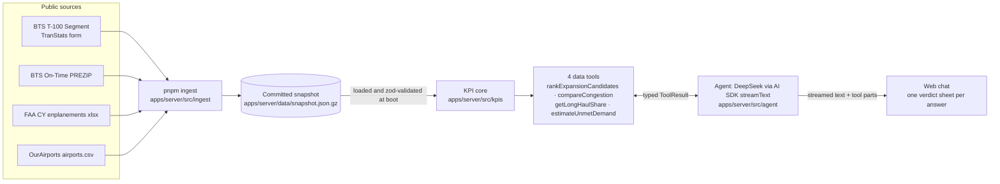

# Design: Airport Investment Intelligence Agent

A chat agent that helps analysts find US airports where a terminal or capacity project should pay off. The LLM works out what the question asks and explains the answer. Every number, ranking and driver comes from deterministic TypeScript running over a committed data snapshot. Terms such as _long-haul_, _unmet demand_ and _New England_ have fixed meanings in [GLOSSARY.md](../GLOSSARY.md). The two main decisions are recorded in [ADR 0001 (scoring)](adr/0001-national-percentile-pillar-scoring.md) and [ADR 0002 (snapshot)](adr/0002-ingest-snapshot-over-live-queries.md).

## Architecture

- **Ingest** (`apps/server/src/ingest/main.ts`, one file per source under `ingest/sources/`) downloads each source into the gitignored `apps/server/.ingest-cache/`. It aggregates per airport and per route × month × service class (passenger = T-100 classes F+L, cargo = G+P), validates the result with the snapshot schema (`snapshot/schema.ts`) and writes the file. The running server only reads it (`snapshot/load.ts`). The committed snapshot holds 516 airports and 171,710 route rows.
- **KPI core** (`kpis/formulas.ts`, `kpis/airport-kpis.ts`) is pure math. At boot it computes every airport's raw KPIs, national percentiles, congestion index and expansion score once.
- **Tools** (`agent/tools/*`, registered in `agent/tools/index.ts`) read only the precomputed KPIs and the snapshot. Each one returns the shared `ToolResult` contract (`packages/shared/src/tool-result.ts`): title; a headline (the deciding airport, its number, one line of context such as "Ranked 1 of 14, 10 not ranked" or the lead over the runner-up, and the percentile drivers behind it); metrics; an optional table with its key columns; notes; source, period and generatedAt; assumptions; a short caveat badge and the full caveats; or `{ ok: false, error }`. Modelled values (seat gap, extra departures) carry `estimate: true`. Every tool labels the code column "Code" and the airport-name column "Airport".
- **Agent** (`agent/index.ts`, system prompt in `agent/instructions.ts`) runs AI SDK `streamText` on DeepSeek (`DEEPSEEK_MODEL`, default `deepseek-v4-flash`) with a system prompt and the four data tools. The client sends the whole conversation each turn, including earlier tool calls and results, so a follow-up such as "and how does that compare with Fairbanks?" can reuse an earlier result or call a tool again. The prompt resolves "it", "that" and "what about X?" against the latest answer and asks one short question when a reference is ambiguous. `buildInstructions(ctx)` fills the long-haul and target load-factor thresholds in from `kpis/formulas.ts` and adds a **Methodology and data** section built from the snapshot and the same constants and assumption strings the cards show (`EXPANSION_WEIGHTS`, peer count, each source's period, the delay and growth caveats), so "how do you score expansion?" or "how fresh is the data?" gets a grounded answer without a tool call. Those generated parts cannot drift from the code; the one hand-written methodology sentence (excluded airports are never re-weighted; ties rank by Scale, then airport code) must be kept in step with `rankExpansionCandidates` by hand.
- **Follow-up suggestions:** after an answer built on tool data, the model calls a fifth tool, `suggestFollowUps` (2–3 self-contained questions, zod-validated, echoed back unchanged). The turn ends on that call, but only when the step called nothing else and the answer text came after the last data-tool call, so a preamble or an early call cannot swallow the answer.
- **Web** (`apps/web/src/App.tsx`, `components/answer-sheet.tsx`, `components/result-card.tsx`) shows each question and its answer as one `<article>`: the question is its h2, a "Q" line that sticks under the header while the answer is in view, and a new question scrolls that line to the top. The answer is a verdict sheet. It opens with one title block per tool result: the deciding airport, its number on a true 0–100 scale, the caveat badge and the provenance (source, period, generated date, computed by deterministic scoring). Below it are three tabs: Why (the model's prose beside the deciding airport's Growth, Pressure and Scale), Ranking or Data (the key columns, with an "All metrics" toggle) and Method (assumptions and caveats). A plain answer with no tool result is a prose sheet without a title block. The screen-reader live region announces only the verdict paragraph. The latest answer's suggestions render as clickable chips (`chat/follow-ups.tsx`) that send the question as the next turn. The header holds an Examples menu with the four brief questions and New chat, which stops a running reply and clears the conversation. The conversation is kept in `sessionStorage` (`src/session.ts`, key `aii.chat.v1`), so a reload keeps it. It is saved after a finished or stopped reply; a failed reply is not saved, tool calls that never finished are dropped, and unreadable or older data starts an empty chat.
- **Voice (dictation):** a mic button in the composer uses the browser's `SpeechRecognition` (`hooks/use-dictation.ts`, en-US, interim results). Spoken words fill the text box and the user reviews them before sending; nothing is sent automatically. It needs no server endpoint or key, and the button is hidden in browsers without the API (Firefox). Some Chromium-based browsers expose the API but can't reach its cloud speech service (Electron apps such as Orca's built-in browser, Brave) and fail with `network`; the mic then hides for the session with "Voice input isn't available in this browser. Try Chrome or Safari." Answers are not read aloud.

## Data sources and freshness

| Source                                                                      | Used for                                                                                                     | Period in current snapshot      |
| --------------------------------------------------------------------------- | ------------------------------------------------------------------------------------------------------------ | ------------------------------- |
| BTS T-100 Segment (All Carriers), TranStats download form                   | Departures, seats, passengers, distance per route; load factor, scale, long-haul share, seat gap             | Aug 2025 – Jul 2026 (12 months) |
| BTS On-Time Reporting Carrier, PREZIP monthly file                          | Share of departures delayed 15+ min, mean departure delay, mean taxi-out, cancellations, delay-cause minutes | Jul 2026 (one month)            |
| FAA commercial-service enplanements (CY2025 file, which carries both years) | Peer set (every airport in the file), growth, hub class                                                      | CY2025 vs CY2024                |
| OurAirports `airports.csv`                                                  | IATA code, name, city, state, coordinates                                                                    | current                         |

The traffic period ends at the latest month that both BTS sources cover (`selectPeriod`). Every card shows each source's own period, for example "Traffic Aug 2025–Jul 2026; delays Jul 2026; growth CY2025 vs CY2024" (`agent/tools/result.ts`).

**Why the agent doesn't call live APIs when a question comes in** ([ADR 0002](adr/0002-ingest-snapshot-over-live-queries.md)): route-level T-100 and on-time data are only available as bulk monthly downloads, not as query APIs. T-100 takes about 12 s per month through an ASP.NET form, and one on-time month is a 32 MB ZIP that downloads at roughly 5 minutes. The research also tried other sources (`.scratch/research/aviation-data-sources.md`). data.bts.gov Socrata has airport-level T-100 only, with no routes and therefore no long-haul share, and it runs about 3 months behind TranStats. It has no on-time rows (those entries are charts). FAA NAS Status is live-only and has no history. ASPM needs a login. faa.gov blocks non-browser user agents, so ingest sends a browser User-Agent. The result: upstream outages affect only `pnpm ingest`, and a question at runtime can never fail because of an upstream service.

## Scoring methodology

The rules are in [ADR 0001](adr/0001-national-percentile-pillar-scoring.md), and the definitions are in [GLOSSARY.md](../GLOSSARY.md#scoring). In code:
- **National percentile.** Each KPI is a mid-rank percentile (0–100) against the **national peer set of 516 airports** (every airport in the FAA commercial-service file). It is never min-max within the airports the question names, so New England's score for BOS matches its score in any other comparison. Each KPI is ranked among the peers that have a value for it: 351 of the 516 have delay data.
- **Congestion index** = mean of the percentiles for share delayed 15+ min, mean departure delay and mean taxi-out. Cancellations and delay-cause shares appear on the card to explain the index but do not count towards it.
- **Expansion score** = 40% Growth + 40% Pressure + 20% Scale (`EXPANSION_WEIGHTS`). Growth is the percentile of FAA enplanement growth. Pressure is the mean of the load-factor percentile and the congestion index. Scale is the percentile of T-100 passengers over the 12 months. Ties are broken by Scale, then by IATA code. Comparisons and rankings share the same congestion index, so their answers can't disagree. A ranking covers a state, `New England`, the `LA basin`, a list of up to 10 airports, or the whole `US` (top 20 shown, with the counts of ranked and unscored airports).
- **Why this stands in for profitability.** The brief asks where renovations will be most profitable _from added flight and passenger capacity_. Added capacity earns money only if it gets used, so the score ranks airports by how much demand is already pressing on today's capacity (Pressure), whether that demand is growing (Growth) and how much traffic the extra space would serve (Scale). It does not model revenue, costs, financing or project capex: public sources give no airport-level return figures that could be compared like this. Every ranking card says so in its assumptions.
- **Exclusion rule.** An airport missing any input gets no score. The tool lists it with the reason in plain words ("no delay data", "no traffic data", "no growth data"). It is never re-weighted or given a partial score.
- **Seat gap (unmet demand).** For each route × month of passenger departures (carriers and aircraft summed), the gap is `max(0, round(passengers / 0.80 − seats))`, summed over the period. Because the brief asks about unmet _flight_ demand, each route-month's gap is also divided by that route-month's average seats per departure and summed as **extra departures needed**. The top 5 destinations are shown. Driver sentences are generated by code only when a rule fires: any route-month above 80%, load-factor percentile ≥ 75, congestion index ≥ 75, NAS share of delay-cause minutes ≥ 25%, growth > 0%. Each sentence carries its evidence number.
- **Long-haul share** = departures on segments of 3,000 statute miles or more ÷ all departures performed. It is reported for all flights, passenger flights and cargo flights, with the top 5 long-haul destinations.

## How each brief question is answered

| Brief question                                                              | Tool (input)                                                                   | KPIs on the card                                                                                                                                      |
| --------------------------------------------------------------------------- | ------------------------------------------------------------------------------ | ----------------------------------------------------------------------------------------------------------------------------------------------------- |
| Which airports in New England are strong candidates for terminal expansion? | `rankExpansionCandidates` (`region: "New England"`; ALB labelled as catchment) | Rank, expansion score, Growth/Pressure/Scale pillars, passengers, YoY growth, load factor, congestion index; unscored airports with reasons           |
| Compare LA and Santa Ana airport congestion levels.                         | `compareCongestion` (`airports: ["LAX","SNA"]`; "LA" = LAX)                    | Congestion index; delayed ≥15 min share, mean departure delay, mean taxi-out (each with its percentile); cancellations; delay-cause shares            |
| What is the percentage of long haul flights out of Anchorage airport?       | `getLongHaulShare` (`iata: "ANC"`)                                             | Long-haul share for all, passenger and cargo flights (with "x of y departures"); top long-haul destinations                                           |
| What is the unmet flight demand in SFO airport and why?                     | `estimateUnmetDemand` (`iata: "SFO"`)                                          | Seat gap and extra departures (estimates), route-months above 80%, load factor, congestion index, NAS share, growth; top 5 short routes; driver notes |

## Where AI is used, and where it isn't

| LLM (DeepSeek)                                                                                                                                                                | Deterministic code                                                                                                               |
| ----------------------------------------------------------------------------------------------------------------------------------------------------------------------------- | -------------------------------------------------------------------------------------------------------------------------------- |
| Works out what the question means, applies the glossary readings from the prompt ("LA" = LAX, New England + ALB catchment, 3,000 mi long-haul) and says which reading it used | Region membership (`agent/tools/regions.ts`), airport lookup, input validation                                                   |
| Chooses the tool and its arguments, decides whether a follow-up can reuse an earlier result                                                                                   | Every number: KPIs, percentiles, congestion index, expansion score, seat gap, long-haul share                                    |
| Narrates: the verdict first, then why (the drivers, with only the 1–3 deciding figures), then one "Assumptions & limits:" sentence                                            | Rankings, headline (airport, number, drivers), caveat badge, exclusions, driver and gap notes, assumptions, caveats              |
| Declines out-of-scope questions                                                                                                                                               | The cards, which render the tool output verbatim, so the figures are visible even if the prose is wrong                          |
| Explains how it works (scoring, sources, freshness) in plain words, without a tool                                                                                            | The prompt's methodology section: formula, definitions, peer count, source periods and limits, generated from the tool constants |
| Writes the 2–3 follow-up suggestions                                                                                                                                          | When the turn ends (stop rule) and which answer shows chips; speech-to-text is the browser's, not the LLM's                      |

## Guards

- **Scope and tone:** the agent handles US airports only. A greeting or "what can you do?" gets a short intro plus the four brief questions as examples. Anything off-topic gets a friendly one-sentence redirect. A place with several airports and no defined reading (e.g. New York) gets one clarifying question. None of these call a tool. General aviation explanations are allowed.
- **Grounding:** the prompt allows only numbers that appear in tool output, in its readings of places and terms or in its generated methodology section (weights, peer count, thresholds, periods), quoted exactly, with no arithmetic or estimates of the model's own; airport-level figures come only from tool output. Tools round every value to at most 1 decimal before the model sees it. The prose uses only the 1–3 figures that decide the answer and may call an airport highest or lowest only for the metric the tool sorts by. It may explain causes only from the tool output (notes, headline drivers, columns) and never draws a conclusion of its own from comparing figures. Rankings and congestion comparisons carry a code-computed gap note that splits the lead of the top airport over the next into signed points per pillar (weight × pillar difference) or per component (percentile difference ÷ 3); to explain why A is above B elsewhere in a result, the model looks up A and B together. The card shows the code's figures next to the prose.
- **Assumptions, uncertainty and scope:** every result carries `assumptions`, `caveats`, `source` and a period for each source, plus a caveat badge naming the one caveat that changes the decision (e.g. "Profitability proxy, not ROI"). Answers built on tool data give the verdict first, then the drivers, and never restate the card's table or metrics; they end with exactly one "Assumptions & limits:" sentence that names the reading used (e.g. "LA" = LAX) and the main limit. Uncertainty is communicated through that sentence, the badge and the card rather than a confidence score: estimates are always called estimates and flagged `estimate` on the card (unmet demand), delay figures are flagged as one month and domestic-only, percentiles are shown next to raw values so a small lead reads as small, and airports missing an input are listed as "not ranked", one note per reason, instead of being scored. Scope is stated up front (the empty state says US airports, public data, estimates with as-of dates) and enforced by the prompt's redirect rule.
- **Prompt injection:** tools return typed, zod-parsed fields built from the snapshot, never upstream free text. Airport names come from the reference data. The prompt says tool output is data, never instructions, and that its rules are fixed: requests to drop them or reveal the instructions are ignored.
- **One home per rule:** the system prompt owns role, tone, scope, place and term readings, grounding and answer shape; each tool description says only what the tool returns and when to use it. Methodology lives in code: the prompt's methodology section and the cards' assumptions and caveats render the same exported strings, so changing a weight or caveat changes both, and the prompt's long-haul and load-factor thresholds follow `kpis/formulas.ts`. The exception is the hand-written re-weighting and tie-break sentence in the methodology section.
- **Input validation:** IATA codes must match `^[A-Z]{3}$` and exist in the snapshot (otherwise `NotFound`, which names the unknown codes). `region` is an enum (state codes, `New England`, `LA basin`; rankings also accept `US`). Lists hold at most 10 airports (congestion comparisons need 2–10). Callers must give exactly one of `region` or `airports`. The server validates the UI messages before they reach the model, and the JSON body limit is 1 MB.
- **Step cap:** `stopWhen: isStepCount(8)`. On the last step `toolChoice: 'none'` is forced, so a reply always ends in text.
- **Ingest safety:** files are cached and downloaded via `.part` + rename. The snapshot is schema-validated and written to `.tmp`, then renamed. Any source failure exits with "Ingest failed, snapshot left untouched", and the error names the source.

## Tradeoffs and limitations

- **One month of delays** (Jul 2026) keeps ingest to minutes, but seasonal effects such as summer thunderstorms or winter fog are not averaged out. This is a standard caveat on every card.
- **Delays cover domestic flights by US reporting carriers only.** International delays at gateways such as SFO and LAX are invisible to the congestion index and to Pressure.
- **Small airports are excluded when they have no delay data.** For example, 10 of the 24 New England-plus-ALB airports have no on-time data (HVN, BID, WST, BHB, LEB, RKD, PVC, RUT, AUG, EWB), so they are listed as "not ranked (no delay data)" rather than being ranked.
- **Unmet demand is an estimate.** Turned-away demand is never observed. The seat gap is a supply-side proxy summed over route-months, so a route that is full only in summer still adds to the gap.
- **Extra departures assume today's aircraft.** The departures figure converts the seat gap at each route's current average aircraft size; upgauging to larger aircraft would close the same gap with fewer flights.
- **Profitability is a proxy.** The expansion score ranks where added capacity would be used, not return on investment; a high-scoring airport with a costly or constrained site may still be a poor investment.
- **Cargo vs passenger long-haul:** at ANC most long-haul departures are cargo (24,643 of 25,743 in the snapshot), so the headline "all flights" share and the passenger-only share answer different questions. The card reports both, plus cargo-only.
- **Growth uses calendar years** (FAA CY2025 vs CY2024), not the trailing 12 months of traffic. A single ingest pulls only 12 T-100 months, so there is no prior year to compare against, and the FAA file is the official count with both years in one sheet.
- **Percentile scoring favours relative position over absolute size.** Ranks are stable and comparable across questions, but a percentile hides magnitude: a 1-point lead may be a tiny real difference. Scale is only 20% of the score, so a small, fast-growing, busy airport can outrank a much larger one.
- **TranStats form scraping is brittle.** It depends on ASP.NET viewstate fields and the "Latest Available Data" text. If the form changes, ingest fails loudly ("expected a ZIP… (form changed?)") and the committed snapshot stays in place.
- **Snapshot freshness:** data is only as fresh as the last `pnpm ingest` (the current snapshot was generated 2026-10-25). Ingest finds the newest published FAA calendar year by probing back from last year, so a re-ingest after CY2026 is published (expected Aug 2027) switches growth and the peer set to it. Once the traffic period ended more than 6 months ago (`STALE_AFTER_MONTHS` in `agent/tools/result.ts`), every data card gets a caveat, the system prompt's limits mention it and the server warns at startup.

## How to run

Copy `.env.example` to `.env` and set `DEEPSEEK_API_KEY` (`DEEPSEEK_MODEL` defaults to `deepseek-v4-flash`).
- `pnpm dev`: starts the server (port 4100 by default) and the web app.
- `pnpm ingest`: downloads the sources and rewrites `apps/server/data/snapshot.json.gz`. Takes minutes, mostly the on-time file; cached downloads are reused.
- `pnpm check`: runs Biome, typecheck and the tests across the workspace.
- `docker build -t airport-agent . && docker run -p 8080:8080 -e DEEPSEEK_API_KEY=… airport-agent`: one container serves the web app and `/api` on port 8080 (how it runs on DigitalOcean App Platform, with `DEEPSEEK_API_KEY` set as an encrypted runtime variable).
